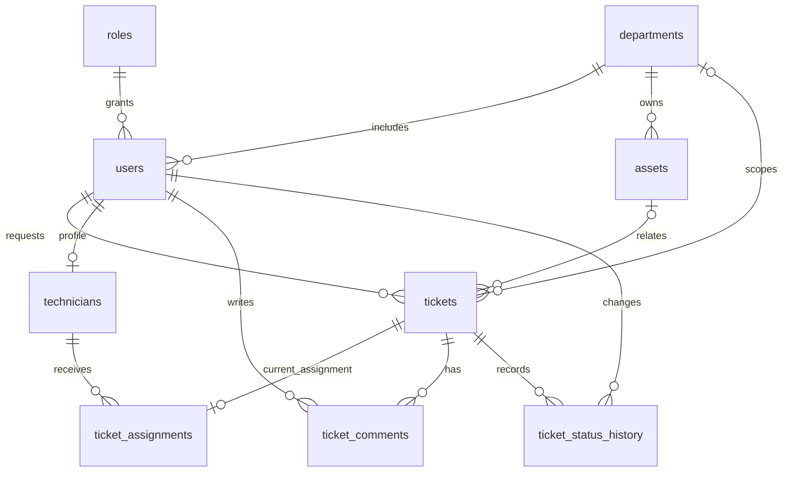

# Architecture

## Responsibilities

React owns login, ticket forms, lists/details, dashboard display, filtering and the read-only asset browser. The shared Fetch wrapper adds bearer tokens, formats API errors, rejects responses from an old session and signals expiration. Dashboard and asset components keep presentation separate from the existing App screen/controller.

FastAPI owns authentication, authorization, Pydantic validation, relationship validation, ticket workflows and response construction. SQLAlchemy manages connections and per-request sessions; queries use bound parameters. MySQL owns durable relational state, referential integrity, indexes and the joined ticket-detail view.

This increment preserves the original framework choices, API response envelopes, SQL view and existing Git history. It does not introduce an ORM model layer or a frontend framework beyond React.

## Authentication flow

1. React posts email/password as OAuth2 form fields to `/auth/login`.
2. The API loads the user's password hash and verifies it with pwdlib/Argon2.
3. Successful login issues an expiring signed JWT containing a string subject (user ID).
4. On authenticated requests, JWT signature and required expiry/subject are validated.
5. The user and **current role** are loaded from MySQL. Token role claims never grant authority.
6. React checks `/auth/me` when restoring login. An expired session clears account state.

## Authorization flow

`security.require_roles` gates role-specific operations. `access.ticket_scope` builds fixed SQL predicates with bound user IDs:

- Admin: all tickets.
- Technician: EXISTS a current assignment whose technician profile belongs to that user.
- Student/Staff: requester ID equals authenticated user ID.
- Unknown role: fail closed.

Ticket lists, dashboards and asset-linked ticket queries use that predicate. Details, comments, history and mutations call `require_ticket_access`. Missing/inaccessible IDs return the same 404 response. Technicians cannot access unassigned work or other technicians' tickets.

Campus asset metadata, departments and the technician directory are shared authenticated reference data. Asset inventory responses omit assigned-user identity.

## Ticket lifecycle

Creation validates department/asset references, infers an omitted department from an asset, and inserts OPEN plus its initial history event in one transaction. Explicit department/asset mismatches return 422.

Admin assignment validates an available technician with a current TECHNICIAN role. It inserts or updates the current assignment. OPEN becomes IN_PROGRESS with a history entry. Reassignment retains status.

Transitions are OPEN → IN_PROGRESS; IN_PROGRESS → OPEN/RESOLVED; RESOLVED → IN_PROGRESS/CLOSED; CLOSED → OPEN for Admin only. Same-status requests are idempotent. Illegal transitions return 409.

Status/assignment mutations lock the parent ticket using MySQL FOR UPDATE before changing it. This serializes changes through the API, including on older installations without the optional assignment uniqueness constraint. SQLite tests omit the unsupported locking clause; real MySQL tests exercise the MySQL query path.

Workflow writes and history share a transaction. The request session rolls back on exceptions. Database failures return a sanitized 503 without SQL/parameters.

## Major relationships

The one-assignment cardinality is enforced by the fresh schema; existing installations can use the additive migration after duplicate review.

## Design decisions

- Use IDs for authorization; display-name joins are presentation only.
- Keep existing endpoint paths and response envelopes to preserve integration.
- Share authorization and lifecycle helpers to prevent route-specific bypasses.
- Share inventory metadata while independently protecting linked ticket data.
- Keep assets read-only rather than adding a large management subsystem.
- Preserve historical records; do not backfill events or reset existing data.
- Use isolated synthetic fixtures for both database engines and browser verification.

For configuration and production limitations, see [SECURITY.md](SECURITY.md).
